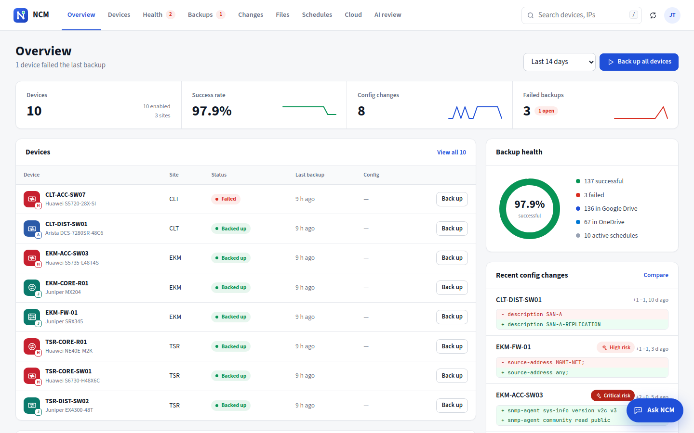

# Network Config Manager (NCM)

[](CHANGELOG.md)
[](#quick-start)
[](#features)
[](#license)

**Open-source, self-hosted network configuration backup and management tool.** NCM backs up the configuration of **Cisco, Huawei, Juniper and Arista** switches, routers and firewalls over **SSH or Telnet**, shows exactly what changed between backups, checks device health, keeps off-site copies in Google Drive and OneDrive, and can use AI to review risky changes — all from one web UI.

Built for NOC and network operations teams who want a simple, private alternative to heavy commercial tools.



> Screenshots use fictional demo data.

## Features

- 💾 **Automatic config backups** — Cisco (IOS/IOS-XE), Huawei (VRP), Juniper (Junos), Arista (EOS), over SSH or Telnet. On demand or on a schedule, with retries, retention and daily backups for every device.
- 🔄 **Change tracking** — per-device timeline and side-by-side diff, with timestamp/header noise hidden and cross-device compare.
- 🔎 **Config viewer & search** — find text across every device's latest config; jump to the line and section; secrets hidden on screen.
- 🩺 **Device health checks** — CPU, memory, power, temperature, interfaces and logs, graded OK / Warning / Critical.
- 🤖 **AI review (optional)** — bring your own provider (Gemini, OpenAI, Anthropic, OpenRouter, Groq, Mistral, FreeLLMAPI, or local Ollama). Scores configs, rates every change and answers questions about your network. Secrets are always masked first.
- ☁️ **Off-site copies** — automatic upload to Google Drive and OneDrive.
- 🔐 **Secure by default** — role-based access, encrypted credentials, strong passwords, sign-in lockout, audit log, security headers and a built-in self-check.
- ⬆️ **In-app upgrades** — NCM tells you when a new version ships and upgrades itself, with one-click rollback.
- 🌙 Dark mode, 📥 CSV import/export, installable as a web app.

## Quick start

Needs Python 3.10+.

```bash
git clone https://github.com/justinthoms/network-config-manager.git
cd network-config-manager
./run-local.sh
```

Then open **http://localhost:8000** and sign in with the admin account from `backend/.env` (`DEFAULT_ADMIN_USERNAME` / `DEFAULT_ADMIN_PASSWORD`). Change the password at first sign-in.

On Debian/Ubuntu you may first need `sudo apt install -y python3-venv python3-pip`.

## Configuration

Settings live in `backend/.env` (copied from [`backend/.env.example`](backend/.env.example) on first run). The ones that matter most:

| Setting | What it does |
|---|---|
| `DEVICE_ENCRYPTION_KEY` | **Required.** Encrypts device passwords and cloud tokens. |
| `SECRET_KEY` | Signs login tokens. Generated automatically if unset. |
| `DATABASE_URL` | SQLite by default; PostgreSQL supported. Use a full path. |
| `BACKUP_ROOT` | Where configuration files are written. |
| `TELEMETRY_ENABLED` | Anonymous version + hostname report; `false` turns it off. |

Schedules, health-check commands, AI providers, cloud backup and usage reporting are all managed in the web UI. Full reference is in `.env.example`.

## Running in production

Run NCM as a systemd service behind HTTPS (nginx or Caddy), since it holds device credentials — treat the server like a jump host. The **Security** page (user menu → Security) lists anything that needs attention. `uvicorn --workers N` is supported.

## Roles

| | Super Admin | Admin | Operator | Viewer |
|---|:-:|:-:|:-:|:-:|
| View dashboards, devices, backups, health | ✓ | ✓ | ✓ | ✓ |
| Run backups, health checks, edit devices | ✓ | ✓ | ✓ | |
| Download configs with secrets | ✓ | ✓ | ✓ | |
| Manage users, cloud, AI, upgrades | ✓ | ✓* | | |

\* Admins manage most things; only a Super Admin creates Super Admins, upgrades NCM, resets another Admin, or changes allowed commands. Roles without download permission always see configs with secrets masked.

## Upgrading

From 2.1 on, a Super Admin upgrades from **user menu → Updates** — NCM downloads the release, tests it on a copy of the database, keeps a rollback copy, and restarts itself. Your `.env`, keys, database and backups are kept. By-hand steps are in each release's notes under [Releases](https://github.com/justinthoms/network-config-manager/releases).

## Security

Report a vulnerability privately via GitHub Security Advisories rather than a public issue. See the [Security section of the docs](#running-in-production) for hardening.

## License

[MIT](LICENSE) © Justin Thomas. Network Config Manager™ and NCM™ are trademarks of Justin Thomas.
